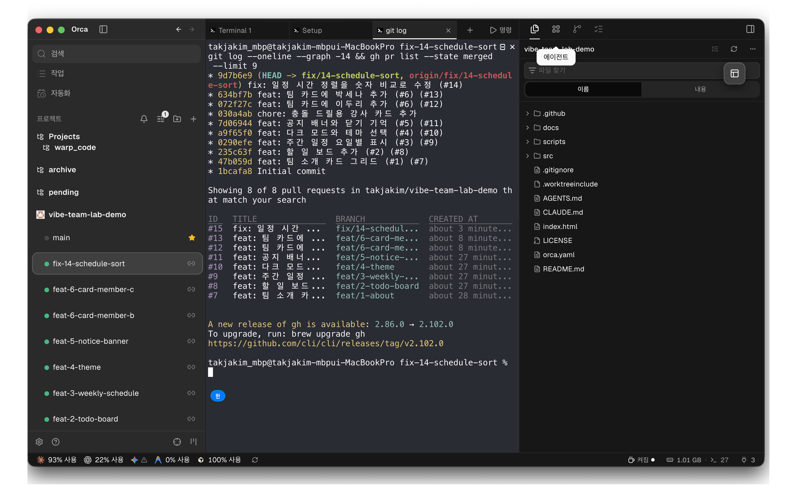
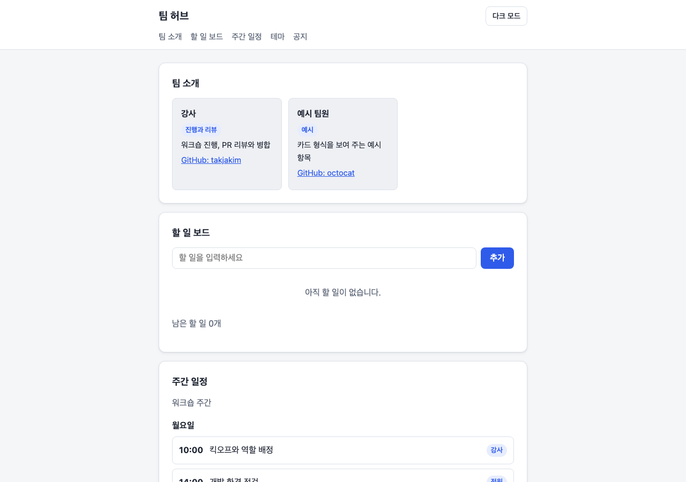

# 진행 기록 — 워크숍 흐름을 실제로 수행한 결과

이 저장소는 템플릿 [takjakim/vibe-team-lab](https://github.com/takjakim/vibe-team-lab)에서 `scripts/new-team-repo.sh takjakim/vibe-team-lab-demo`로 생성한 뒤, 3시간 워크숍의 실습 2~4를 그대로 수행한 완성 예시다. 모든 작업은 Orca 워크트리에서 코딩 에이전트(Claude Code)가 구현하고 gh CLI로 PR을 열었다. 단일 계정으로 진행했으므로 승인(approve) 리뷰는 남길 수 없어 main 보호 규칙의 승인 수를 0으로 두었고, 변경 요청은 "[변경 요청]" 머리글의 코멘트 리뷰로 남겼다.

## 1. 저장소 생성 (실습 1)

- 템플릿 복제, Pages 활성화, 라벨 9개, 이슈 #1~#6 생성, main 보호(PR 필수·`check` 통과 필수)까지 스크립트 한 번으로 끝났다.
- Orca에 저장소를 등록하고 역할별 워크트리 5개를 `orca worktree create --issue N`으로 만들었다. 기본 경로는 `~/orca/workspaces/vibe-team-lab-demo/<이름>`이며, Orca가 만든 브랜치 이름에 GitHub 아이디 접두가 붙어 `git branch -m feat/N-...`으로 팀 규칙에 맞췄다.

## 2. 이슈에서 PR까지 (실습 2)

| 역할 | 이슈 | 워크트리 · 브랜치 | PR | 변경 파일 |
|---|---|---|---|---|
| A 팀 소개 | #1 | `feat-1-about` · `feat/1-about` | #7 | `src/sections/about.js` |
| B 할 일 보드 | #2 | `feat-2-todo-board` · `feat/2-todo-board` | #8 | `src/sections/board.js` |
| C 주간 일정 | #3 | `feat-3-weekly-schedule` · `feat/3-weekly-schedule` | #9 | `src/sections/schedule.js` |
| D 테마 | #4 | `feat-4-theme` · `feat/4-theme` | #10 | `src/sections/theme.js`, `src/styles/theme.css` |
| E 공지 | #5 | `feat-5-notice-banner` · `feat/5-notice-banner` | #11 | `src/sections/notice.js` |

각 PR 본문은 템플릿대로 변경 요약, `Closes #N`, 확인 사항, `에이전트: Claude Code` 줄을 담았다. 담당 파일만 고쳤으므로 다섯 PR 사이에 충돌은 없었다.

## 3. 리뷰와 병합 (실습 3)

리뷰어는 워크트리마다 `node scripts/check.mjs`를 돌리고 로컬 서버를 띄워 헤드리스 브라우저로 화면과 동작(클릭·입력·새로고침·손상된 저장값)을 확인한 뒤 리뷰를 남겼다.

| PR | 리뷰 | 요청한 수정 | 수정 커밋 | 병합 |
|---|---|---|---|---|
| #7 | 변경 요청 + 줄 코멘트 | `@id` 형식 아이디가 `github.com/%40id`로 링크돼 404. `@`를 제거 | e8fc5a1 | 47b059d |
| #8 | 코멘트 | 존재한 적 없는 저장 형식용 `legacy-` id 처리 제거 제안 | 없음 | 235c63f |
| #9 | 코멘트 | 시간 문자열 정렬 오류(`9:00`이 `14:00` 뒤), 빈 문단 렌더 제안 | 없음 | 0290efe |
| #10 | 변경 요청 + 줄 코멘트 | `.theme-toggle`이 `.btn` 규칙 6줄을 중복하고 글자 굵기를 400으로 떨어뜨림 | 70529fa | a9f65f0 |
| #11 | 변경 요청 + 줄 코멘트 | 닫기 버튼의 aria-label이 모두 같고 닫은 뒤 포커스가 body로 빠짐 | d08beff | 7d06944 |

병합은 `check` 통과를 기다린 뒤 `gh pr merge N --squash`로 했다. 원격 브랜치는 저장소 설정으로 자동 삭제되고, 로컬 워크트리는 그대로 남는다.

## 4. 충돌 드릴 (실습 4)

1. 학습자 b·c가 각각 워크트리 `feat-6-card-member-b`, `feat-6-card-member-c`에서 `src/data/team.json` 끝에 자기 카드를 추가하고 PR #12, #13을 열었다(`Refs #6`).
2. 강사가 `scripts/conflict-drill.sh takjakim/vibe-team-lab-demo`를 실행해 main에 강사 카드를 넣었다(030a4ab). 두 PR이 즉시 CONFLICTING 상태가 됐다.
3. b 워크트리에서 `git fetch origin && git rebase origin/main` → `team.json` 충돌. 마커 사이의 두 카드를 모두 남기고 `=======` 자리에 `},` `{`를 넣어 배열을 이었다. `node scripts/check.mjs` 통과 → `git add src/data/team.json && GIT_EDITOR=true git rebase --continue` → `git push --force-with-lease` → PR #12 병합(072f27c).
4. c 워크트리도 같은 절차. 이번에는 HEAD 쪽에 강사 카드와 b 카드 두 개가 들어 있는 모양이었다. 세 카드를 모두 남겨 PR #13 병합(634bf7b).
5. 이슈 #6을 닫았다. main의 `team.json` 순서: 강사, 예시 팀원, 강사(충돌 드릴), 이두리, 박세나.

해결 전 검사 스크립트는 "15행에 병합 충돌 표시(`<<<<<<<`)가 남아 있습니다"로 실패했다. 마커를 지우기 전에는 커밋이 되지 않는다는 점을 확인하는 장치다.

## 5. 병렬 작업 — 실제 버그 수정

리뷰 #9에서 발견한 결함을 이슈 #14(`type:bug`)로 올리고 워크트리 `fix-14-schedule-sort`에서 `schedule.js`의 정렬을 `H:MM`을 분 단위 숫자로 바꿔 비교하도록 고쳤다. PR #15 → `check` 통과 → 병합(2a92f26). 이슈 #14는 `Closes #14`로 자동 종료됐다.

## 6. 결과

- 병합된 PR 8건(#7~#13, #15), 종료된 이슈 7건(#1~#6, #14).
- CI(`check`)와 Pages가 모든 병합에서 성공. 배포 사이트: https://takjakim.kr/vibe-team-lab-demo/

## 7. 진행하며 확인한 점

- 관리자 계정은 보호 규칙(`enforce_admins: false`)을 우회해 main에 직접 푸시할 수 있다. 드릴 스크립트는 그 경로로 동작했고, PR 대체 경로는 이번에 쓰이지 않았다.
- `git rebase --continue`는 편집기를 열 수 있으므로 실습에서는 `GIT_EDITOR=true git rebase --continue`(Windows PowerShell은 `git -c core.editor=true rebase --continue`)를 쓴다.
- 두 번째 이후 충돌 해결자는 HEAD 쪽에 카드 여러 개와 `},` `{`가 섞여 보인다. 첫 번째 모양과 다르다는 점을 미리 알려 주면 당황하지 않는다.
- 단일 계정 데모라 승인 리뷰·CODEOWNERS 자동 배정은 재현하지 못했다. 실제 팀 저장소에서는 승인 1명 규칙이 켜진다.
